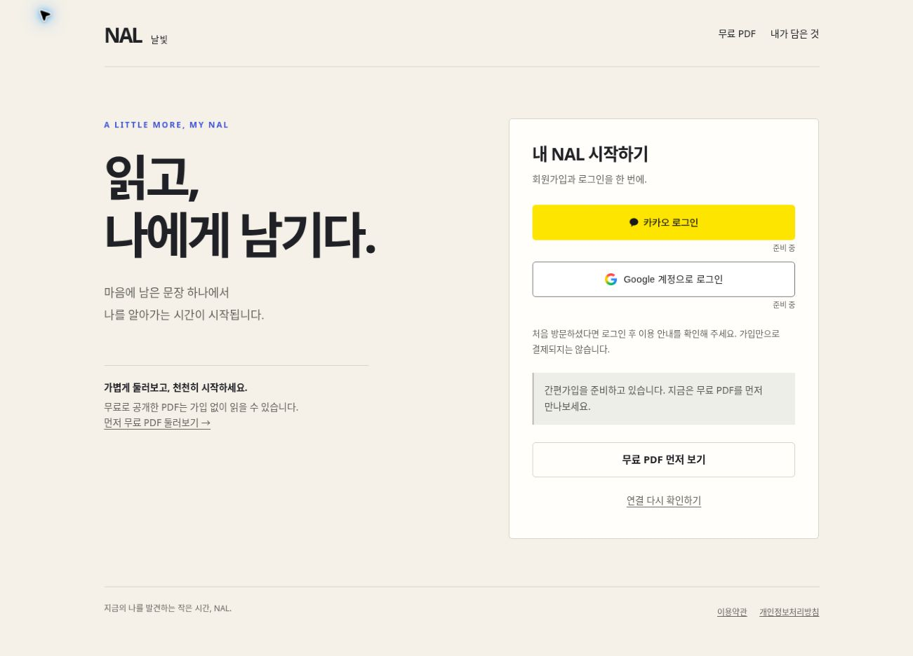
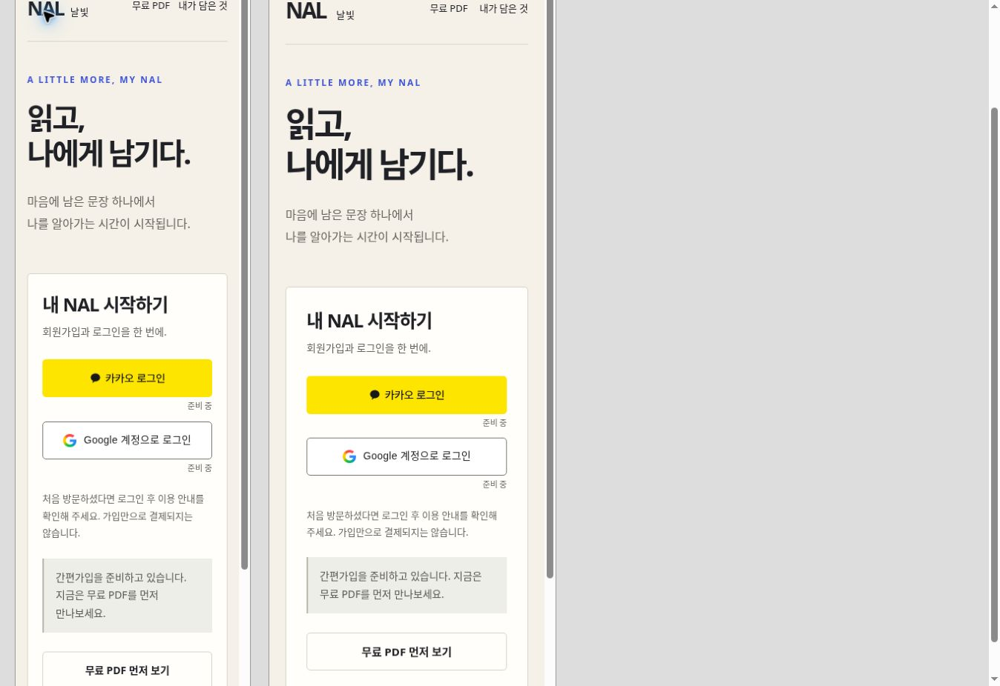

# NAL 소셜 회원가입 검증 기록

검증일: 2026-10-31. 브랜치: `feat/nal-social-membership-20261031`.

## 결과

회원가입 소스와 PDF 정기구독 설계를 준비했다. **운영 배포, 실제 Kakao·Google OAuth 성공, 구독 서버 가동, PG 계약 또는 실제 청구 완료를 의미하지 않는다.**

| 검증 | 결과 | 범위 |
| --- | --- | --- |
| `node scripts/test-nal-member-auth.mjs` | 46개 통과, 실패 0개 | Auth·저장소·동의·계정 전환 계약 및 비동기 회귀 테스트; SDK/서버는 테스트 더블 사용 |
| `node scripts/test-nal-toss-payments.mjs` | PASS | 기존 단건 결제 handler 회귀 테스트 |
| JavaScript 문법 | PASS | `member-auth.js`, `member-pages.js`, `app.js`, `generate-nal-pages.mjs` |
| `git diff --check` | PASS | 공백 오류 확인 |
| 실제 Supabase JS 2.117.2 로컬 실행 | PASS | 배포 UMD로 Kakao·Google authorization URL 및 flow ID 형식 검증; 명시 flow ID의 탭별 verifier 보존 확인 |
| 데스크톱 브라우저 | PASS | 공식 브랜드 버튼·준비 상태·무료 PDF 안내 표시 |
| 320px·390px iframe 너비 | PASS | 버튼/문구 겹침 없음. 스크롤바 제외 실제 client/scroll width 각각 305/305, 375/375; 가로 넘침 없음 |
| 콜백 취소 화면 | PASS | 가상 `access_denied` 입력 후 취소 안내, query/fragment 즉시 제거, 재시작 동선 표시 |
| 계정 페이지 준비 상태 | PASS | 인증 성공이나 회원정보를 허위로 표시하지 않음 |
| 운영 공개 카탈로그와 정적 파일 일치 | 실패: 기존 차이 발견 | 운영 `programs`에 `life-control-monthly-gather`가 더 있음; 이번 변경은 해당 카탈로그·검사 파일을 수정하지 않음 |

최초 공개 API 검사는 네트워크 DNS 제한으로 실행되지 않았고, 네트워크가 허용된 실행에서 실제 비교 결과를 확인했다. 위 카탈로그 비교는 첫 불일치에서 종료되어 이후 항목까지 통과했다고 해석하지 않는다. 회원 코드 실패와 기존 공개 데이터 불일치를 구분한다.

## 집중적으로 확인한 위험

- `/nal/` 내부의 허용된 경로로만 돌아가며 외부 URL, 인코딩·경로 정규화 우회, 로그인 반복 경로를 차단한다.
- 인증 코드를 주소에서 먼저 지우고 SDK로 한 번만 교환한다. 오류의 원문·코드·토큰을 화면에 반영하지 않는다.
- localStorage의 실제 쓰기·읽기·삭제가 실패하면 인증을 시작하지 않는다. SDK의 메모리 fallback으로 PKCE 복귀가 끊기는 경우를 방지한다.
- 탭마다 sessionStorage에 보관한 flow ID를 사용한다. 다른 탭의 인증 흐름을 임의로 빌려 코드 교환하지 않는다.
- 서버가 확인한 사용자 UUID로 프로필과 동의를 조회한다. 저장 완료 후 실제 재조회가 성공해야 가입 완료를 표시한다.
- 계정 조회·가입 저장 중 다른 탭에서 사용자가 바뀌면 이전 결과를 폐기한다. 현재 사용자를 한 번 다시 확인하고 다른 회원에게 표시명·동의를 기록하지 않는다.
- 이메일 없는 카카오 회원의 가입 가능성과 유료 결제의 기존 이메일 확인 조건을 분리한다.

## 운영 상태의 읽기 전용 확인

NAL 전용 프로젝트 `tdglznjjkgaulerbduwt`의 공개 Auth 설정에서 Kakao·Google이 모두 `false`임을 확인했다. 공개 카탈로그의 회원·결제·보호 다운로드 기능도 꺼져 있다. 기존 `nal_profiles`·`nal_consents` 스키마, GRANT와 RLS 정의를 읽기 전용으로 확인했고 운영 데이터는 변경하지 않았다.

**정의 확인은 RLS의 실제 사용자별 종단 테스트를 대체하지 않는다.** 실제 제공자 계정 로그인, 허용 callback, 새 기기·카카오톡 인앱브라우저, 사용자별 데이터 차단, 운영 동의 저장과 회원 탈퇴 처리는 개통 전에 별도 검증해야 한다. 현재 설정은 `authEnabled:false`, `policyVersion:null`이다.

## 시각 검증 이미지

아래는 로컬 검토 환경에서 캡처한 화면이며 운영 사이트 배포 증거가 아니다. 휴대폰 캡처는 브라우저 안의 너비별 iframe 비교이며 실제 휴대폰 OS·앱 인증 테스트가 아니다.

## 후속 문서

- [회원가입 구현·개통 설정](NAL_SOCIAL_MEMBERSHIP_SETUP_20261031.md)
- [PDF 구독 과금 설계](NAL_PDF_SUBSCRIPTION_DESIGN_20261031.md)

CI의 실제 실행 결과는 이 브랜치 PR의 `NAL member auth checks` 실행 기록을 따른다. 위 로컬 테스트 결과를 원격 CI 성공으로 대신 표시하지 않는다.
